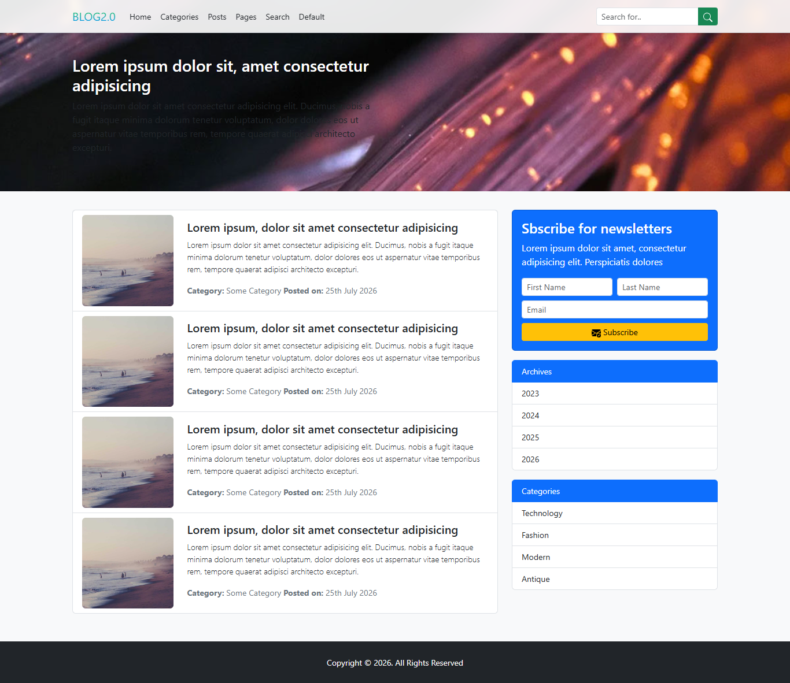
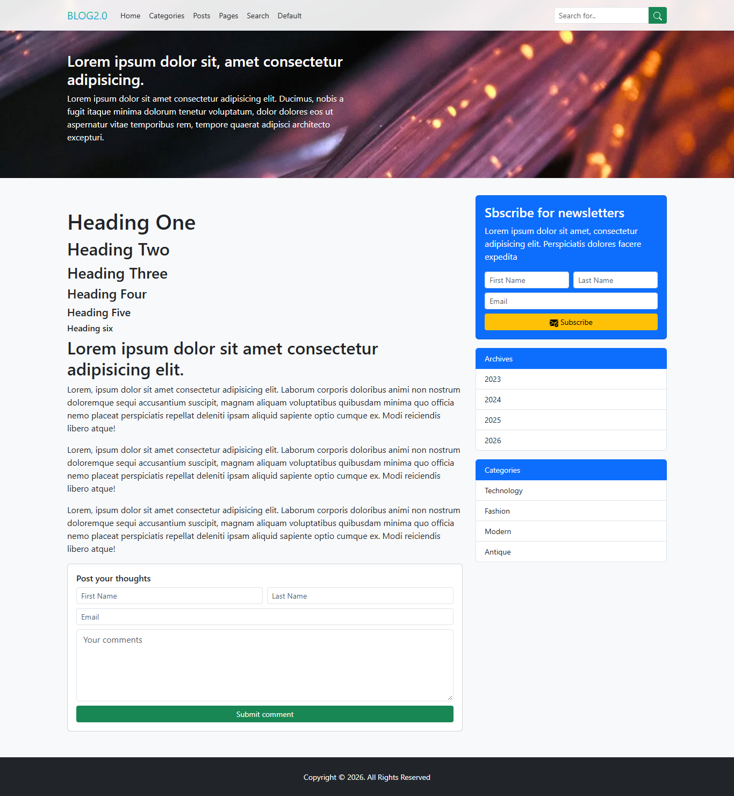

# Blogar (BLOG 2.0) 📝

A sleek, modern, and fully responsive **Blog & Magazine HTML5 Template** built with **Bootstrap 5** and custom CSS. Designed for content creators, personal blogs, tech portals, and digital publications seeking a clean, fast-loading, and easily customizable template.

---

## 📸 Preview

### 🏠 Home Page


### 📂 Category & Post Listings


### 📖 Single Post & Discussion


---

## ✨ Features

- **📱 Fully Responsive Design**: Seamlessly adapts across mobile phones, tablets, laptops, and desktops.
- **🎨 Modern Aesthetic**:
  - Frosted-glass navigation bar with smooth backdrop blur.
  - Vibrant gradient logo branding.
  - Clean card-based layouts and subtle drop shadows.
- **📑 Comprehensive Page Templates**:
  - `index.html`: Hero banner, newsletter modal trigger, and featured post grid.
  - `posts.html`: Single article view with typography hierarchy, featured media, and comment form.
  - `default.html`: Category & archive feed with post summary cards and sidebar.
  - `search.html`: Dedicated search results view with metadata badges and search bar.
  - `page.html`: Standard static page template for "About", "Privacy Policy", or "Terms".
- **📬 Newsletter Integration UI**:
  - Modal newsletter signup popup on the homepage.
  - Sidebar newsletter subscription forms on content pages.
- **💬 Community Interaction**: Built-in post comment form template for user engagement.
- **⚡ Lightweight & Fast**: Zero complex dependencies or build steps—ready to run out of the box using modern CDNs.

---

## 🛠️ Built With

- **[HTML5](https://developer.mozilla.org/en-US/docs/Web/HTML)** – Semantic and accessible structure
- **[CSS3](https://developer.mozilla.org/en-US/docs/Web/CSS)** – Custom gradient accents, backdrop filters, and typography
- **[Bootstrap 5.3.8](https://getbootstrap.com/)** – Grid system, modals, navigation, and UI components
- **Bootstrap Icons & SVG** – Lightweight vector iconography

---

## 📂 Project Structure

```text
Blog App/
├── img/
│   ├── Banner.jpg          # Header background banner
│   └── post-image.jpg      # Placeholder post thumbnail
├── ReadmeImages/
│   ├── Main Page.png       # Screenshot of home page
│   ├── categories.png      # Screenshot of categories view
│   └── post.png            # Screenshot of single post view
├── default.html            # Category / archive listing template
├── index.html              # Main homepage template
├── page.html               # Generic static page template
├── posts.html              # Single blog article & comment form template
├── search.html             # Search results page template
├── style.css               # Custom styles & brand theme definitions
└── README.md               # Project documentation
```

---

## 🚀 Getting Started

### Prerequisites

No build tools, package managers, or compilers are required. All external libraries are loaded via CDN.

### Installation & Running Locally

1. **Clone the repository:**
   ```bash
   git clone https://github.com/sajidsam/Blogar.git
   ```

2. **Navigate to the project directory:**
   ```bash
   cd Blogar
   ```

3. **Launch the project:**
   - Double-click `index.html` to open it in your default web browser, **or**
   - Use VS Code with the [Live Server extension](https://marketplace.visualstudio.com/items?itemName=ritwickdey.LiveServer), **or**
   - Run a lightweight Python web server:
     ```bash
     python -m http.server 8000
     ```
     Then open `http://localhost:8000` in your browser.

---

## 🎨 Customization

### Changing Brand Colors & Logo
Modify `.brand-gradient` in [`style.css`](style.css) to adjust your brand's color palette:
```css
.brand-gradient {
    background: linear-gradient(to top, #0091ff, #32cd4c);
    -webkit-background-clip: text;
    background-clip: text;
    color: transparent;
}
```

### Changing the Banner Image
Replace `img/Banner.jpg` or update the CSS rule in [`style.css`](style.css):
```css
.banner-holder, .main-page-header {
    background-image: url('img/Banner.jpg');
    background-size: cover;
    background-position: bottom;
}
```

---

## 🌐 Browser Compatibility

Tested and compatible with:
- Google Chrome (latest)
- Mozilla Firefox (latest)
- Microsoft Edge (latest)
- Apple Safari (latest)

---

## 📄 License

This project is open source and available under the [MIT License](LICENSE).

